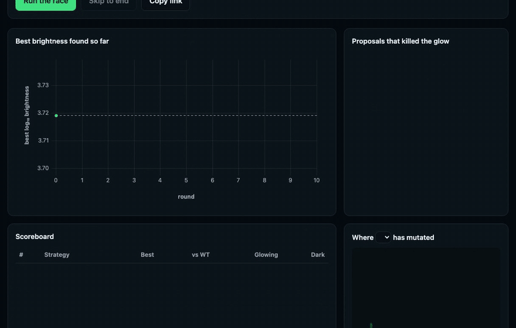

# glowfinder

**Can an AI evolve a brighter protein? Scored against real lab data, round by round.**

Five strategies hunt for a brighter jellyfish protein (avGFP). Every guess must be a variant that
Sarkisyan et al. actually measured in 2016, so every score is a real measurement, never a model
grading another model.



**Live:** https://glowfinder.troche.workers.dev

| Strategy | What it knows | Default race, 20 seeds: best (log₁₀) / dark proposals of 50 |
|---|---|---|
| Random | Nothing | 3.914 / 4.4 |
| Conservative | Substitution chemistry (BLOSUM62) | 3.941 / 2.3 |
| ESM-2 35M | Protein language model, never saw this experiment | 3.843 / 8.0 |
| **Evolution** | Which residues ~400 natural GFP relatives carry | **3.964 / 0.0** |
| LLM (llama-3.2-3b) | General reasoning about structure and chemistry | 3.880 / 6 (one recorded run, 4 of 10 replies unparseable) |

Wild type is 3.719. Numbers come from `node scripts/bakeoff.ts` and the committed recording.

## The landscape

Built from the raw figshare TSV (`pipeline/landscape-summary.md`): 54,025 genotypes. 2,310 contain a
stop codon and are excluded, leaving **51,715 variants**. A variant is "visibly fluorescent" when its
log₁₀ brightness is above 2.5.

| Mutations | Variants | Still glowing | Brighter than wild type |
|---:|---:|---:|---:|
| 1 | 1,084 | 91.6% | 223 |
| 2 | 12,777 | 89.0% | 2,352 |
| 3 | 12,336 | 74.9% | 1,489 |
| 4 | 9,387 | 54.4% | 633 |
| 5 | 6,825 | 33.5% | 238 |
| 6 | 4,298 | 18.7% | 73 |
| 7 | 2,526 | 9.1% | 17 |
| 8 | 1,364 | 4.5% | 5 |
| 9+ | 1,117 | 1.1% | 1 |

The peak is narrow. Half of all four-mutation variants are dark, and only 1 in 10 variants beats wild
type at all.

## Rebuilt from raw, checked against ProteinGym

The variant table was rebuilt from the raw figshare data. **It agrees with ProteinGym's
`GFP_AEQVI_Sarkisyan_2016` at Spearman ρ = 0.9999, with 100% coverage**
([`pipeline/crosscheck-report.md`](pipeline/crosscheck-report.md)). The 483 variants that differ were
all seen through several nucleotide genotypes. ProteinGym reports the *mean of per-genotype medians*,
while the figshare TSV reports the *median over barcodes*. Recomputing ProteinGym's statistic from
the raw nucleotide TSV reproduces it to within 1e-14, so the gap comes from the choice of statistic,
not from a bug.

| Zero-shot model | Spearman ρ, ours | ProteinGym published |
|---|---:|---:|
| ESM-2 8M (masked marginals) | 0.078 | 0.078 |
| ESM-2 35M (masked marginals, shipped) | 0.131 | 0.131 |
| Evolutionary profile (site-independent, shipped) | 0.664 | 0.649 |

## What the offline bake-off changed

The plan said to confirm, before building any UI, that ESM-2 beats random. **It doesn't, not on
GFP.** ESM-2's score has almost no correlation with brightness among variants with the same number of
mutations (ρ ≈ 0.05). The bigger checkpoints are no better (ProteinGym: 150M 0.10, 650M 0.11, 3B 0.15).
GFP has few relatives in UniRef, so a single-sequence language model has little to go on.

So glowfinder races **five** strategies instead of four. ESM-2 stays in, and its result is reported
as measured. A site-independent profile built from ProteinGym's GFP alignment (396 sequences, about
14 effective) was added. It is just as zero-shot, additive and precomputed, and it never proposes a
dark variant under the default settings. The lesson gets sharper rather than weaker: domain-specific
training only helps when the domain covers your protein. The full sweep is in
[`pipeline/bakeoff-report.md`](pipeline/bakeoff-report.md).

## Architecture

```
┌─ OFFLINE (once, Python, `uv run glowfinder-pipeline`) ───────────────┐
│ figshare TSV ─┐                                                      │
│ UniProt, AF ──┼─► clean (+2 offset, F64L construct) ─► encode ─► data/artifacts/ (committed)
│ ESM-2 35M ────┤   masked marginals → 238×20 matrix                   │
│ ProteinGym MSA┘   evolutionary profile → 238×20 matrix               │
│ ProteinGym DMS ──► cross-check (gates the pipeline, not shipped)     │
└───────────────────────────────┬──────────────────────────────────────┘
                                ▼
┌─ RUNTIME (Cloudflare Workers, free tier) ────────────────────────────┐
│ Static assets: app (35 KB gz) + artifacts (~450 KB gz)               │
│ Browser: seeded engine; random, conservative, ESM-2, evolution       │
│          strategies; zero server cost                                 │
│ Worker:  /api/config, /api/session (Turnstile), /api/llm-move        │
│          rate limit → session → strict validation → neuron budget    │
│          (SQLite Durable Object) → Workers AI                        │
└──────────────────────────────────────────────────────────────────────┘
```

Four of the five strategies never touch the server. Runs are seeded, and the seed is in the URL, so
anyone can reproduce a race exactly.

## Gotchas you will hit with this dataset

- **+2 offset.** The TSV numbers residues from 0, starting at S2. Every parsed wild-type letter is
  checked against the reference, and the pipeline stops at the first mismatch.
- **The reference is not UniProt P42212.** The construct that was mutagenised carries **F64L**. This
  is translated from the figshare reference DNA, and ProteinGym's target sequence agrees. If you
  validate against P42212, position 64 fails.
- **Brightness is log₁₀.** Never average it as if it were linear.
- **"Low confidence" is most of the data.** 50,035 of 51,715 genotypes were seen on a single barcode.
  Filtering on `uniqueBarcodes ≥ 2` leaves about 1,700 variants. They are flagged, never dropped.
- **ProteinGym's score is a different statistic.** See the cross-check section above.

## Honest limitations

- Strategies can only pick variants that were measured; a real campaign can make any mutation.
- Model scores add up single-mutation effects and deliberately ignore epistasis.
- The models are small: ESM-2 35M, a site-independent profile, and a 3B-parameter LLM.
- The 3D view is AlphaFold's model of P42212 (F64), not the L64 construct.
- The recorded LLM run is a single run. Live runs vary.

## Cost

| Resource | Free limit | Usage |
|---|---|---|
| Worker requests | 100,000/day | Static assets are served without invoking the Worker; only `/api/*` runs code |
| Workers AI | 10,000 neurons/day | LLM only, about 19 neurons per round and about 190 per run. The circuit breaker stops at `NEURON_DAILY_BUDGET` (8,000) |
| Durable Objects | SQLite-backed (Free plan) | One counter object |
| KV | — | Not used |

The LLM is off by default, and the recorded run costs nothing. On the Workers Free plan,
overspending is impossible.

## Run it

```sh
npm install
npm run dev                     # http://localhost:5173 (static app, recorded LLM run)
npm run build && npx wrangler dev   # app + Worker on :8787 (copy .dev.vars.example to .dev.vars)
```

Tests:

```sh
npm test                        # 113 unit tests + 50 Worker tests (in workerd)
npx playwright install chromium && npm run test:e2e   # 25 UI tests, desktop and mobile
cd pipeline && uv sync && uv run pytest               # 60 pipeline tests (incl. ESM-2 8M)
```

The central regression test (`test/unit/engine.test.ts`) asserts that, over 20 seeded runs, the
evolutionary profile beats random.

Re-run the pipeline with `cd pipeline && uv run glowfinder-pipeline`, and re-record the LLM run with
`npm run record-exemplar` (needs `wrangler dev` running).

## Deploy

Deploys are manual; there is no CI. Run the tests, then:

```sh
npm run deploy                  # build + wrangler deploy → https://glowfinder.troche.workers.dev
```

One-time setup, already done for this deployment:

1. A managed Turnstile widget (`npx wrangler turnstile widget create glowfinder --domain
   glowfinder.troche.workers.dev --domain localhost --domain 127.0.0.1 --mode managed`). Its public
   site key is `TURNSTILE_SITE_KEY` in `wrangler.toml`.
2. Two Worker secrets: `TURNSTILE_SECRET_KEY` (the widget's secret) and `SESSION_SIGNING_KEY` (random,
   e.g. `openssl rand -base64 32`), set with `npx wrangler secret put`. Without them,
   `/api/session` and `/api/llm-move` answer `LLM_UNAVAILABLE` and the app plays the recorded run.
   Secrets survive redeploys.

The Worker accepts a Turnstile token only if siteverify reports the `llm_session` action and a
hostname listed in `TURNSTILE_HOSTNAMES`. To deploy under another hostname, add it to the widget
(`wrangler turnstile widget update`) and to that variable. Local development uses the test keys in
`.dev.vars` (copied from `.dev.vars.example`).

## Data and license

The measurements are from Sarkisyan et al. 2016, published on figshare under CC BY 4.0. They are
redistributed here after re-indexing, filtering and quantizing. ProteinGym's data and code are MIT;
UniProt and AlphaFold DB are CC BY 4.0. See [`docs/specs.md` §3.4](docs/specs.md) for what was
checked. This is an educational, non-commercial project and is not a design tool.

- Sarkisyan, K.S. et al. (2016). *Local fitness landscape of the green fluorescent protein.* Nature 533:397–401. doi:10.1038/nature17995
- Notin, P. et al. (2023). *ProteinGym: Large-Scale Benchmarks for Protein Fitness Prediction and Design.* NeurIPS Datasets and Benchmarks.
- Lin, Z. et al. (2023). ESM-2, Meta AI. Meier, J. et al. (2021), masked-marginal scoring.
- UniProt P42212; AlphaFold DB AF-P42212-F1 (EMBL-EBI); BLOSUM62 (Henikoff & Henikoff 1992).

Topics: `protein-engineering` `esm2` `deep-mutational-scanning` `directed-evolution` `bioinformatics`
`cloudflare-workers` `typescript`
