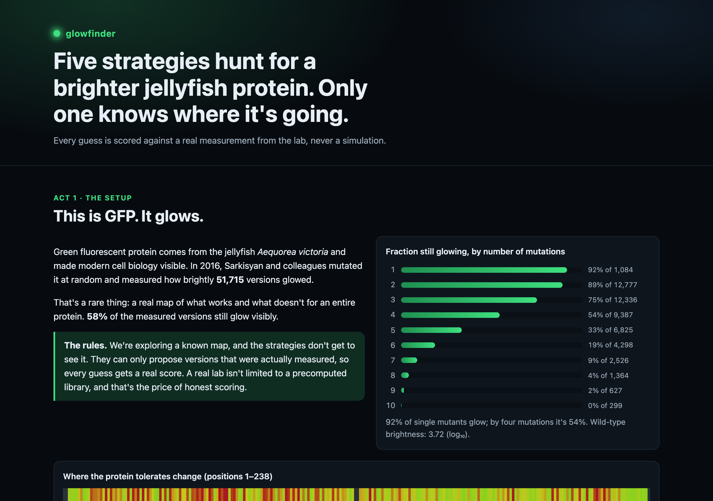
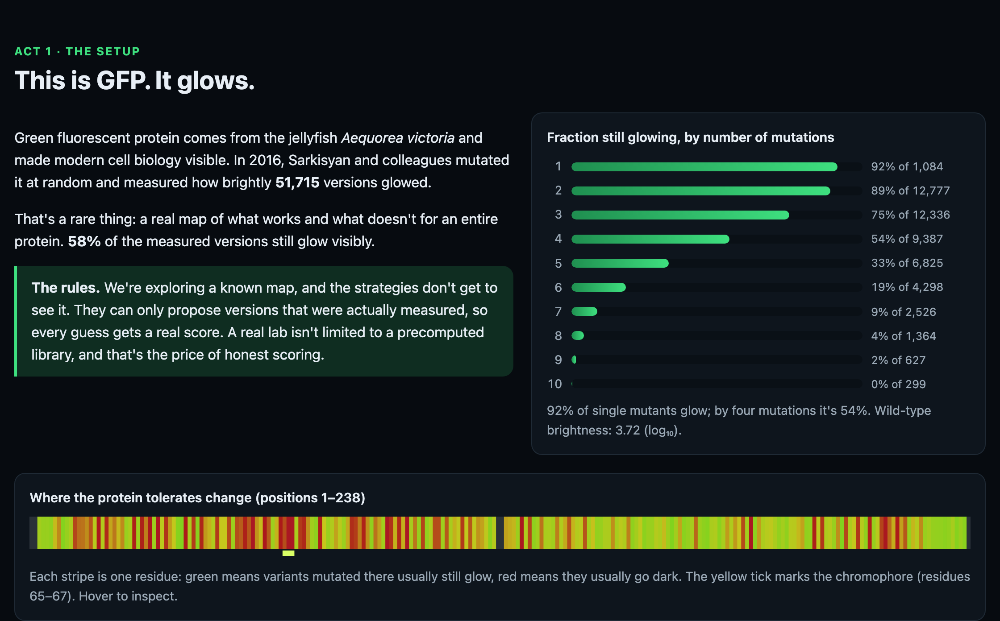
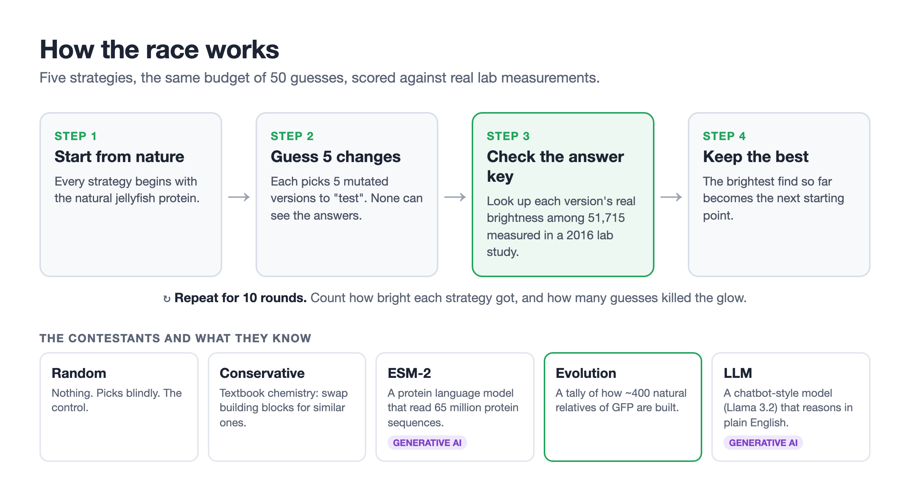
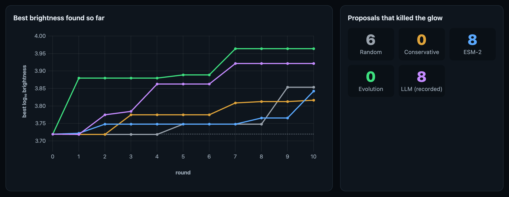
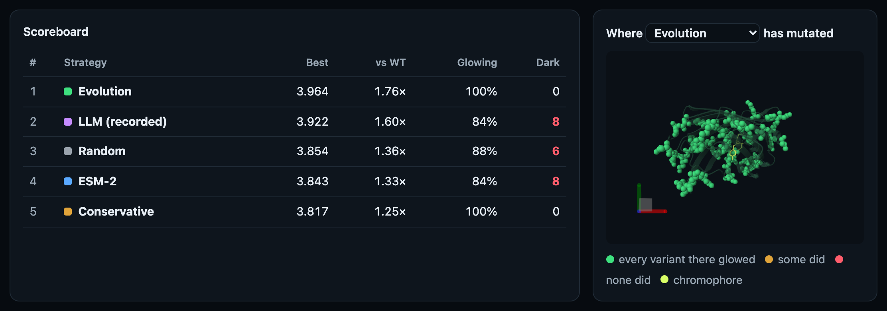
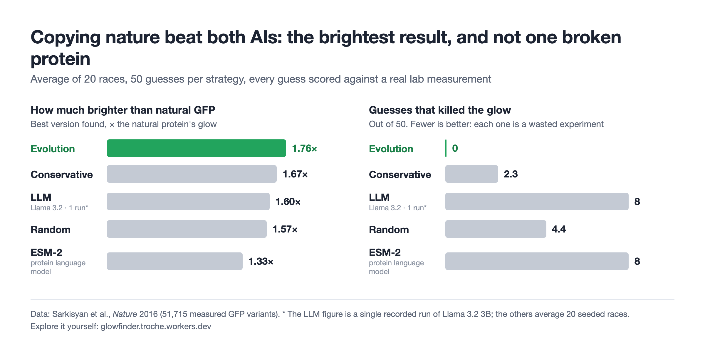
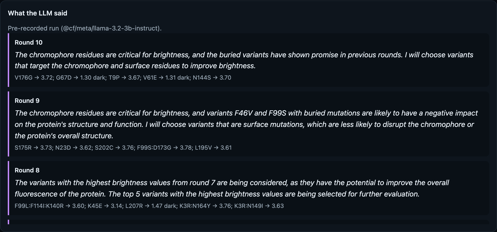

# Why is biotech betting big on AI? A glowing example for non-experts

*I raced two AIs against nature to make a jellyfish glow brighter. Here's what that taught me about where generative AI shines, and where it only sounds smart.*

I wanted to try generative AI in biotech for myself, beyond the headlines. Most AI-in-biology demos are hard to judge unless you have a PhD. So I looked for an experiment that anyone could follow: one protein, a goal you can see (make it glow brighter), and a real answer key to check every guess against.

I found it in a jellyfish. I built a small web app, **glowfinder**, that lets AI and simpler methods compete on a real lab dataset. The result surprised me, and I think the lesson applies far beyond biology.

You can run the race yourself in about a minute: [glowfinder.troche.workers.dev](https://glowfinder.troche.workers.dev)

## The protein that lights up biology

Green fluorescent protein, or GFP, is what makes the *Aequorea victoria* jellyfish glow green. Scientists borrowed it as a living highlighter. Attach it to another protein and you can watch tumors grow or neurons fire under a microscope. Its discovery won the 2008 Nobel Prize in Chemistry.

A protein is a chain of building blocks called amino acids. GFP's chain is 238 links long, and each link can be one of 20 types. Swap one link and you get a "mutant." A few mutants glow brighter. Most glow dimmer, and many go completely dark.

Here is the problem every protein engineer faces. The number of possible GFP variants is larger than the number of atoms in the universe. A lab can test only a tiny fraction, and every test costs time and money. **That is why biotech is betting on AI**: if a model can point to the few promising candidates, scientists can skip thousands of dead ends.

## A rare thing: a complete answer key

Usually you can't tell how good an AI's suggestion is until someone runs the experiment. But in 2016, a team led by Karen Sarkisyan [measured the brightness of tens of thousands of GFP mutants](https://doi.org/10.1038/nature17995) and published the results in *Nature*. After cleaning, that's **51,715 variants, each with a real lab measurement**.

For my purposes, that dataset is an answer key. Any strategy can guess, and I simply look up what actually happened in the lab. No AI grades another AI.

The data also shows how unforgiving proteins are:

With one change, 92% of variants still glow. With four changes, only about half do. Only about 1 in 10 measured variants is brighter than the natural protein. Finding them is like walking a narrow ridge in the dark.

## The race

I set up a simple game. Five strategies start from the natural protein. Each gets the same budget: 10 rounds of 5 guesses, 50 in total. After every round they get the real lab results for their own guesses, and the best one becomes their next starting point.

There is one rule that keeps it honest: strategies can only pick variants that were actually measured. A real lab could try anything, but then there would be no answer key. The strategies never see the brightness of a variant until they've "tested" it.

## How generative AI plays, and why

Two of the five contestants are generative AI. They are built the same way as ChatGPT: trained on huge amounts of data to predict what comes next. They differ in what they read.

**ESM-2, a protein language model.** Meta trained it on 65 million natural protein sequences, the way a chatbot trains on text. It learned the "grammar" of proteins: which building block tends to appear where. Ask it about a mutation and it tells you how natural that change looks. The bet is that natural-looking proteins work better. This kind of model is a real research tool in drug and enzyme design today.

**An LLM, the chatbot kind.** I used Llama 3.2, a small open model from Meta. Each round it gets a briefing in plain English: which candidates it can choose from, where each change sits in the protein (on the surface, buried inside, near the part that glows), and how its previous guesses turned out. It picks 5 and explains why. It never sees the answers for candidates it hasn't tried.

Why use generative AI here at all? Because it promises two things a lab badly wants. First, a shortlist: rank a huge space of options so you test the most promising ones first. Second, an explanation a human can read, question and learn from.

The other three are baselines. **Random** picks blindly. **Conservative** follows textbook chemistry and swaps building blocks for similar ones. **Evolution** is not AI at all: it is a tally of how about 400 natural relatives of GFP are built. If nature tolerates a change at some position, Evolution assumes it's probably safe.

## What happened

Here is one race as it plays out in the app. The lines show the brightest protein each strategy has found so far. The counters on the right show how many guesses killed the glow entirely.

One race can be luck, so I ran the four built-in strategies 20 times with different random seeds. The pattern held:

- **Evolution won.** It found the brightest protein, 1.76 times brighter than the natural one on average. In all 20 races it never proposed a single variant that went dark.
- **The protein language model did worse than random.** It found less bright proteins and wasted more guesses: 8 dark out of 50, against 4.4 for blind picks.
- **The chatbot was persuasive and mediocre.** In the recorded run it landed in the middle of the pack and killed the glow 8 times.

The chatbot's explanations are worth reading, because they sound like an expert:

In round 10 it wrote that "the chromophore residues are critical for brightness" (the chromophore is the tiny part of GFP that actually glows) and then chose to change exactly that part. That guess, G67D, went dark. The reasoning was fluent. It just wasn't grounded in anything the model actually knew about this protein.

## Why this is interesting

I expected the AI trained on 65 million proteins to win. That was the plan when I started. The data said otherwise, and the reason is the most useful thing I learned.

**1. The right data beats more intelligence.** ESM-2 learned from proteins in general, but GFP has very few relatives in its training data, so it had little to go on for this protein. Researchers have measured the same thing at scale: on the [ProteinGym benchmark](https://proteingym.org), ESM-2 versions nearly 100 times larger barely do better on GFP. The Evolution tally is crude, but it is built from GFP's own family. Relevant beat big.

**2. Fluent is not the same as correct.** The chatbot produced the most convincing explanations of any contestant and some of the worst guesses. If I had only read its reasoning, I'd have trusted it. Only the answer key exposed it.

**3. Wrong guesses have a price.** In a real lab, each dark variant is an experiment you paid for and learned little from. Counting failures, not just the best result, changed how I see these tools. Evolution's zero is worth more to a lab than a slightly brighter lucky find.

**4. You need a way to keep score.** This experiment only works because a lab measured 51,715 real proteins. Without that, I would have been grading AI predictions with other AI predictions.

To be fair to AI: this is not a verdict on AI in biology. AI has transformed protein science. AlphaFold's ability to predict protein shapes earned the 2024 Nobel Prize in Chemistry. My models are small, they made one-shot guesses without learning from the lab, and my setup is a simplified game. Bigger and better-trained systems do better. But the pattern is real, and it's the same one I see outside the lab.

## Beyond biology: the same pattern everywhere

Strip away the jellyfish and the problem looks familiar. **There is a huge space of options, testing each one is expensive, and AI promises to tell you which few to try first.** That describes a lot of work:

- **Drug discovery.** Choosing which of millions of molecules or antibodies to synthesize and test. A dead-end candidate can cost months.
- **Industrial enzymes.** Designing proteins that break down plastic, work in cold-water detergents or make biofuels.
- **Agriculture.** Picking which crop variants to breed for drought or heat tolerance.
- **Materials and batteries.** Choosing which chemical recipes to make in the lab.
- **Business experiments.** Deciding which product features, prices or campaigns to A/B test, when each test burns time and traffic.
- **Engineering and operations.** Choosing which configuration, supplier or schedule to try next.

The glowfinder lessons transfer directly:

1. **Ask what your AI has actually seen of your problem.** A general model that sounds expert may know very little about your specific product, customers or molecule. Often a simple model built on your own data is the stronger start.
2. **Don't grade AI by how convincing it sounds.** Grade it against reality, with an answer key, a holdout set or a real experiment.
3. **Count the misses, not just the wins.** Every bad recommendation costs something. A tool that never wastes a shot can beat one that occasionally hits big.
4. **Use generative AI where it's strong.** It is great at summarizing, explaining, brainstorming and turning knowledge into something people can act on. Pair it with real data and real tests when the decision matters.

## Try it, and tell me what you see

The race runs in your browser, uses the real lab data, and every race has a link you can share. Change the settings and see if you can make any strategy beat Evolution: [glowfinder.troche.workers.dev](https://glowfinder.troche.workers.dev)

I'd love to hear from people in biotech, and from people in other fields. Where have you seen an AI sound confident and turn out wrong? And where has a simple, well-grounded model quietly beaten a fancy one?

---

*Sources and notes.* Measurements: Sarkisyan, K.S. et al. (2016), *Local fitness landscape of the green fluorescent protein*, Nature 533:397–401, [doi:10.1038/nature17995](https://doi.org/10.1038/nature17995). Benchmark and evolutionary data: Notin, P. et al. (2023), *ProteinGym*. Models: ESM-2 35M (Meta AI) and Llama 3.2 3B Instruct. 20-race averages use the app's default settings (10 rounds, 5 guesses, up to 3 changes from the current best); the LLM figures come from one recorded run. glowfinder is an educational project, not a protein design tool.
